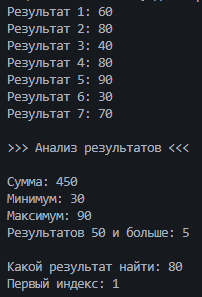

# Практическая работа №17
Автор: Белоярова Александра

Группа: ИСП-251
## Тема
Алгоритмы обработки массивов.
## Что реализовано
- сумма элементов;
- подсчёт элементов по условию;
- минимум и максимум;
- линейный поиск;
- поиск первого индекса.
## Короткие ответы
1. Почему максимум нельзя всегда начинать с `0`?

Ответ: Если в массиве все числа отрицательные то 0 будет больше всех и программа выведет 0 хотя его в массиве нет. Поэтому в начале берём первый элемент массива и сравниваем остальные с ним

2. Что означает `-1` после поиска индекса?

Ответ: Это значит что такого числа в массиве нет. Индексы начинаются с 0 поэтому -1 не может быть номером настоящего элемента

3. Чем сумма отличается от подсчёта элементов?

Ответ: В сумме мы складываем сами числа, а при подсчёте прибавляем по 1 за каждый подходящий элемент

## Результат
